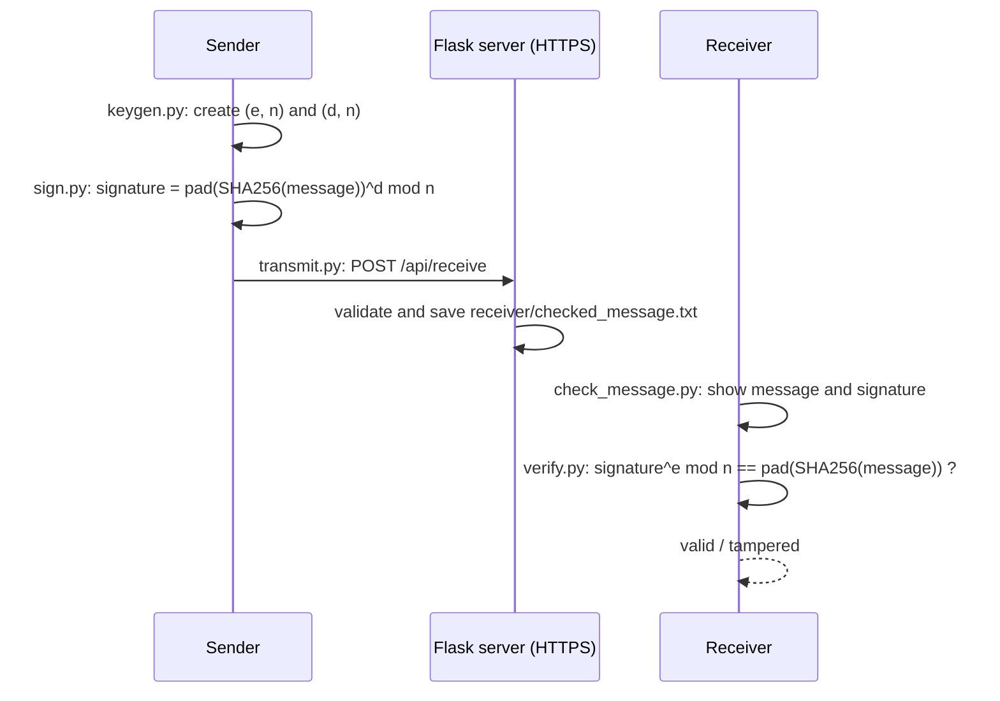

# Digital Signature using RSA

An RSA digital signature workflow in Python. A **sender** generates an RSA key pair, signs a message, and transmits it over **HTTPS** to a Flask **server**. A **receiver** then verifies the signature to confirm the message's **integrity** and **authenticity**.

The RSA maths (prime search, key generation, modular exponentiation) is written by hand to show how signing works, using standard building blocks: Miller-Rabin primality testing, a CSPRNG (`secrets`), `e = 65537`, 2048-bit keys, and PKCS#1 v1.5 padding with SHA-256. Signatures produced here are accepted by the `cryptography` library's PKCS#1 v1.5 verifier (checked during development).

> **Status:** working, tested prototype for learning and demonstration. It has not been security-audited. For protecting real data, use a vetted library. See [Limitations](#limitations).

---

## Table of contents

1. [Features](#features)
2. [How it works](#how-it-works)
3. [Project structure](#project-structure)
4. [Prerequisites](#prerequisites)
5. [Installation](#installation)
6. [Quick start](#quick-start)
7. [Testing tamper detection](#testing-tamper-detection)
8. [Running the tests](#running-the-tests)
9. [Server API](#server-api)
10. [Configuration](#configuration)
11. [Deploying to Render](#deploying-to-render)
12. [Troubleshooting](#troubleshooting)
13. [Limitations](#limitations)
14. [Roadmap](#roadmap)
15. [Tech stack](#tech-stack)

Design details, algorithms and the module reference are in [`docs/DOCUMENTATION.md`](docs/DOCUMENTATION.md).

---

## Features

- RSA key generation: Miller-Rabin primes from a CSPRNG, 2048-bit modulus, `e = 65537`
- SHA-256 hashing with PKCS#1 v1.5 padding before signing
- Verification with the sender's public key; any change to the message makes it fail
- Flask server that receives signed messages over HTTPS (auto-generated self-signed certificate for local use)
- Browser page to submit a signed message and download the stored one
- Separate `sender/` and `receiver/` folders that simulate two independent parties
- Every script works from any directory, and `verify.py` returns exit code 0 (valid) or 1 (invalid) for use in scripts and CI
- 18 automated tests covering primes, keys, signatures, parsing and the API

---

## How it works



**Signing:** `signature = pad(hash(message))^d mod n`
**Verifying:** `signature^e mod n` must equal `pad(hash(message))`

Change one character of the message and the hash changes, so verification fails.

---

## Project structure

```
Digital-Signature-RSA/
├── README.md
├── requirements.txt
├── runtime.txt               # Python 3.10.12 (hosting)
├── .gitignore                # keeps keys, certificates and generated files out of Git
├── docs/
│   └── DOCUMENTATION.md
├── utils/
│   └── rsa_utils.py          # primes, keys, sign / verify, file parsing
├── sender/
│   ├── keygen.py             # create sender key pair
│   ├── sign.py               # sign a message
│   └── transmit.py           # POST signed message to the server
├── server/
│   ├── app.py                # Flask app: /, /api/receive, /api/download
│   └── static/index.html     # send / download page
├── receiver/
│   ├── keygen.py             # create receiver key pair (reserved for encryption)
│   ├── check_message.py      # display message and signature
│   └── verify.py             # verify the signature
└── tests/
    └── test_rsa.py
```

Generated at runtime (and git-ignored): `sender/public_key.txt`, `sender/private_key.txt`, `sender/message.txt`, `sender/signed_message.txt`, `receiver/checked_message.txt`.

---

## Prerequisites

- Python **3.10+**
- `pip` and Git

---

## Installation

```bash
git clone https://github.com/Shrinavv/Digital-Signature-RSA.git
cd Digital-Signature-RSA

python -m venv venv
# Windows (PowerShell):  venv\Scripts\Activate.ps1
# Windows (cmd):         venv\Scripts\activate.bat
# macOS / Linux:         source venv/bin/activate

pip install -r requirements.txt
```

---

## Quick start

All commands work from any directory; examples assume the project root.

**1. Generate the sender's keys** (about a second)

```bash
python sender/keygen.py            # add --bits 3072 for a larger key
```

**2. Sign a message**

```bash
python sender/sign.py
```

Type your message when asked. This writes `sender/message.txt` and `sender/signed_message.txt` (line 1: message, last line: signature).

**3. Start the server** (second terminal, virtual environment activated)

```bash
python server/app.py
```

It serves `https://127.0.0.1:5000`. With no certificate files present, Flask generates a temporary self-signed one, so your browser will show a warning. That is expected locally.

**4. Transmit the signed message**

```bash
python sender/transmit.py
```

Expected: `📡 Message successfully transmitted to the receiver via HTTPS!`. The server saves it as `receiver/checked_message.txt`.

**5. View and verify**

```bash
python receiver/check_message.py
python receiver/verify.py
```

Expected:

```
✅ Signature is valid! Message integrity verified.
```

**Alternative to step 4:** open `https://127.0.0.1:5000`, paste the contents of `sender/signed_message.txt` into the box and press **Send Message**.

---

## Testing tamper detection

1. Complete the quick start so verification succeeds.
2. Open `receiver/checked_message.txt` and change one character on the **first line** (the message).
3. Run `python receiver/verify.py`.

Expected (exit code 1):

```
❗ Signature is invalid! Message may have been tampered.
```

You can also verify any file against any key: `python receiver/verify.py path/to/signed.txt path/to/public_key.txt`.

---

## Running the tests

```bash
python -m unittest discover -s tests -v
```

The suite checks: known primes and composites (including Carmichael numbers that fool the Fermat test), key properties, valid / tampered / wrong-key signatures, input parsing (including Windows line endings), and the API (empty, malformed and valid requests, download before and after upload).

---

## Server API

Base URL (local): `https://127.0.0.1:5000`

| Method | Endpoint        | Description |
|--------|-----------------|-------------|
| GET    | `/`             | HTML page to send and download messages |
| POST   | `/api/receive`  | Form field `signed_message` (message, newline, signature). Validated, then saved to `receiver/checked_message.txt` |
| GET    | `/api/download` | Downloads the stored message as an attachment |

| Status | Meaning |
|--------|---------|
| 200 | Saved |
| 400 | Field missing, empty, or not in `message\nsignature` format |
| 404 | Nothing stored yet (download) |
| 413 | Payload larger than 64 KB |

```bash
# curl example (-k accepts the self-signed certificate)
curl -k -X POST https://127.0.0.1:5000/api/receive \
     --data-urlencode "signed_message@sender/signed_message.txt"
curl -k -O -J https://127.0.0.1:5000/api/download
```

The server keeps **one** message; each new POST replaces the previous one.

---

## Configuration

| Setting | How | Default |
|---------|-----|---------|
| Key size | `python sender/keygen.py --bits N` | 2048 |
| Server port | `PORT` environment variable | 5000 |
| Server host | `HOST` environment variable | 127.0.0.1 (use `0.0.0.0` to expose on the network) |
| Receiver URL for the sender | `--url` flag or `SIGNATURE_SERVER_URL` | `https://127.0.0.1:5000/api/receive` |
| TLS certificate | put `cert.pem` and `key.pem` in `server/` | auto-generated if absent |

Create your own certificate (optional):

```bash
openssl req -x509 -newkey rsa:4096 -nodes \
  -keyout server/key.pem -out server/cert.pem -days 365 -subj "/CN=localhost"
```

`transmit.py` skips certificate checks **only** for `localhost` / `127.0.0.1`; any other URL is verified normally.

---

## Deploying to Render

1. Push the repo to GitHub (make sure no key files are committed).
2. In Render, create a **Web Service** from the repo.
3. Build command: `pip install -r requirements.txt`
4. Start command: `gunicorn --chdir server app:app`
5. Render sets `PORT` and terminates HTTPS for you.
6. Send from your machine: `python sender/transmit.py --url https://<your-app>.onrender.com/api/receive`

Free instances have an ephemeral disk, so the stored message disappears on restart. A database is needed for persistence (see the roadmap).

---

## Troubleshooting

| Problem | Cause | Fix |
|---------|-------|-----|
| `sender/private_key.txt not found` | Keys not generated | `python sender/keygen.py` |
| `signed message not found` when transmitting | `sign.py` not run | `python sender/sign.py` |
| `Connection refused` | Server not running | Start `python server/app.py` in another terminal |
| `receiver/checked_message.txt not found` | Nothing sent yet | Run `python sender/transmit.py` |
| `invalid file format` | File is not `message` + signature digits | Re-sign and resend; do not edit the signature line |
| Browser security warning | Self-signed certificate | Expected locally; continue manually |
| `Invalid format` (HTTP 400) from the server | Signature missing or not numeric on the last line | Paste the whole `signed_message.txt` |

---

## Limitations

- **No audit.** Hand-written cryptography is for learning. Production code should use a vetted library.
- **PKCS#1 v1.5, not PSS.** v1.5 padding is still widely used and is not broken for signatures, but PSS is the modern recommendation.
- **No timing-attack hardening** on private-key operations (`pow` is not constant time).
- **No identity binding.** The receiver trusts whatever is in `sender/public_key.txt`. A real system needs certificates or a registry tying keys to users.
- **Signed, not encrypted.** Messages travel over HTTPS but are not encrypted at the application level.
- **No replay protection.** An old valid message can be re-sent; timestamps or nonces would fix this.
- **Single stored message** on the server.

---

## Roadmap

- [x] Miller-Rabin, CSPRNG, `e = 65537`, 2048-bit keys, PKCS#1 v1.5 padding
- [x] Server validation, textarea UI, hosting-ready `app.py`
- [x] Unit and API tests
- [ ] Deploy to Render and confirm the URL works for everyone
- [ ] Username and password database so a sender can address a specific receiver, with per-user public keys
- [ ] Choose the transport protocol based on the receiver's username
- [ ] RSA-PSS padding
- [ ] Encrypt messages with the receiver's public key
- [ ] Timestamps and nonces against replay

---

## Tech stack

Python 3.10 · Flask · Requests · Gunicorn · `hashlib` (SHA-256) · `secrets` · HTTPS · HTML/CSS/JS · `unittest`

---

## License

No license has been chosen yet. Add a `LICENSE` file (for example MIT) before sharing publicly.
